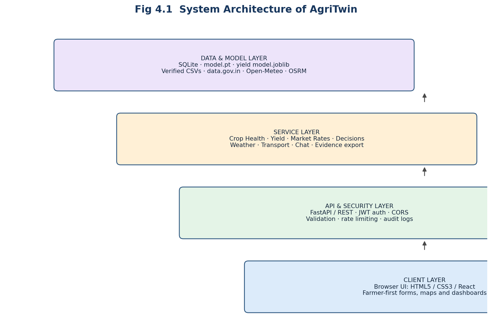
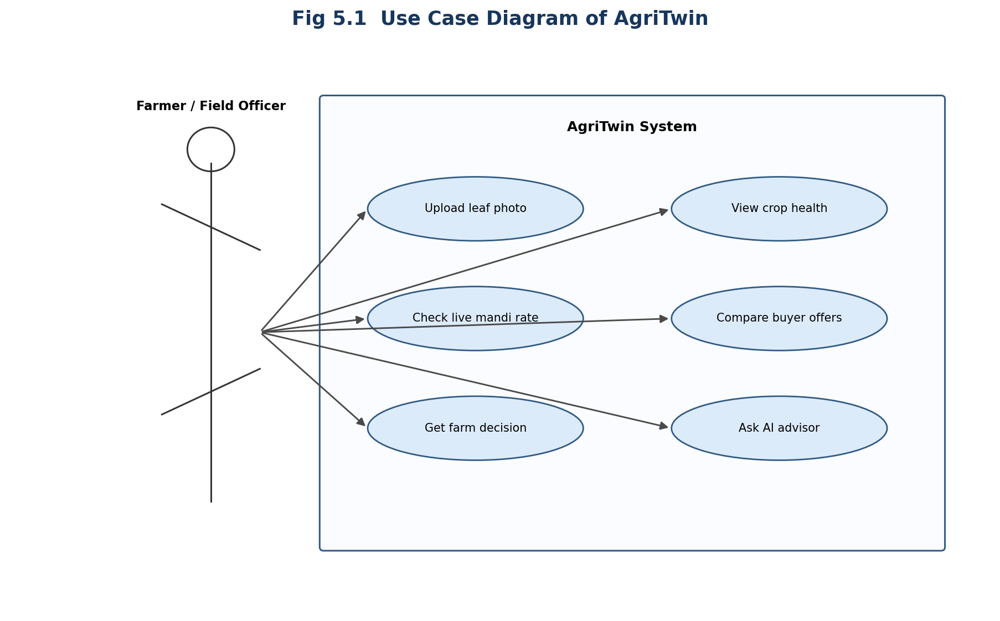
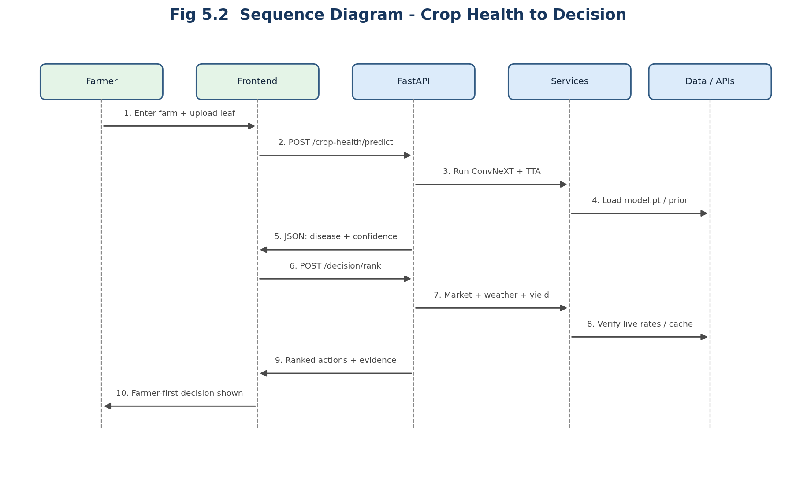
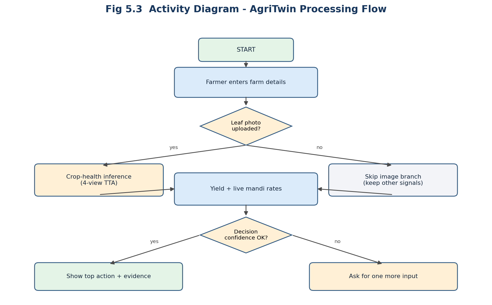
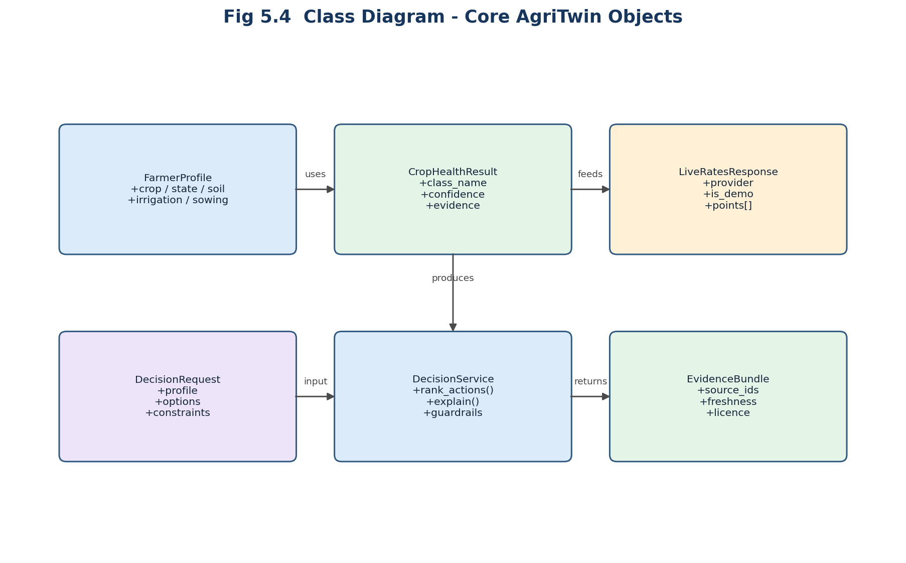
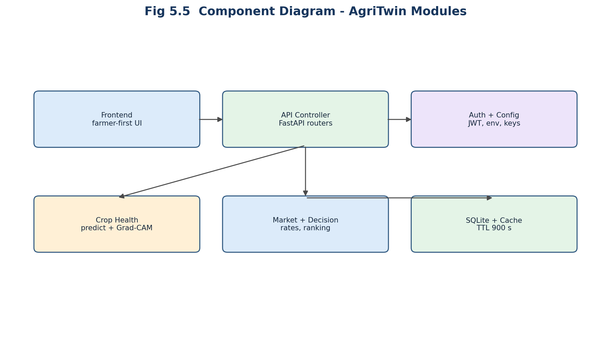
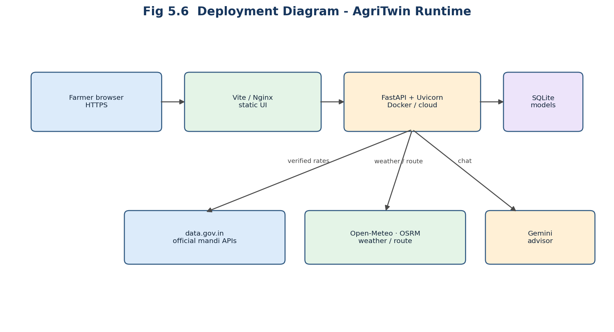

> **A MINI PROJECT REPORT**

> On

# AGRITWIN: REAL-DATA DIGITAL TWIN FOR CROP HEALTH, YIELD, MARKET AND DECISION SUPPORT

> Submitted to

## OSMANIA UNIVERSITY

> In partial fulfillment of the requirements for the award of

## BACHELOR OF ENGINEERING

> in

## COMPUTER SCIENCE AND ENGINEERING (AI & ML)

> by

> Aravapalli Jashwanth 245523748071

> Kolluru Sai Vamshi 245523748097

> Mandula Sri Sreshta 245523748103

> Under the esteemed guidance of

## Mrs. D . Padmaja Usha Rani

> Assistant Professor

## DEPARTMENT OF COMPUTER SCIENCE AND ENGINEERING

> KESHAV MEMORIAL ENGINEERING COLLEGE

> (Approved by AICTE, New Delhi & Affiliated to Osmania University, Hyderabad)

> D.No. 10 TC-111, Kachavanisingaram (V), Ghatkesar (M), Medchal-Malkajgiri, Telangana – 500088

> July 2026

---

## ACKNOWLEDGEMENT

We take this opportunity to express our sincere gratitude to everyone who supported us during the design, development and testing of this mini project. The work would not have been possible without the guidance, facilities and encouragement we received from our college and department.

We are grateful to Mr. Neil Gogte, Founder Director, for providing the facilities and amenities required to carry out this project. We express our heartfelt gratitude to Prof. P. V. N. Prasad, Principal, Keshav Memorial Engineering College, for his continuous support and for giving us the opportunity to undertake this work.

We extend our sincere thanks to Ms. Deepa Ganu, Director Academics, for fostering an excellent academic environment. We also thank Dr. P. Naresh Kumar, Head of the Department, CSE (AI & ML), for his constant encouragement, inspiration and for arranging the resources needed for the successful completion of the project.

We are deeply grateful to our internal supervisor, Mrs. D. Padmaja Usha Rani, Assistant Professor, Department of CSE (AI & ML), Keshav Memorial Engineering College, for her valuable guidance, encouragement and continuous moral support throughout the project. We also thank our project coordinator, Dr. B. Devender, Assistant Professor, for his guidance and support.

Finally, we express our heartfelt gratitude to all faculty members of the Department of Computer Science and Engineering, as well as our friends and families, for their suggestions, encouragement and support.

> Aravapalli Jashwanth 245523748071

> Kolluru Sai Vamshi 245523748097

> Mandula Sri Sreshta 245523748103

---

## ABSTRACT

A farmer who wants to sell produce often has to combine several pieces of information at the same time: the price in the nearest mandi, an offer made by a buyer over the phone, an idea of how much grain the field may produce, the health of the crop, and the cost of transport. These pieces of information usually arrive in different places and at different times. AgriTwin brings them together in one web application and converts them into one clear next step: **sell now, wait, or inspect the crop first**.

The system is called a digital twin because it keeps a living digital picture of a farm and its crop. The picture is built from the farmer’s own records, an uploaded leaf photograph, historical crop-production data, official mandi prices and optional weather and route information. Whenever a new observation arrives, the digital picture is updated and the recommendation is recalculated.

AgriTwin uses a ConvNeXT-Tiny image model to suggest a crop-health class from a leaf photograph, an ExtraTrees model to estimate yield with an uncertainty range, two official data.gov.in resources to show current mandi rates, and a rule-based decision engine to rank actions under the farmer’s constraints. The decision engine is deliberately not a large language model: it follows a versioned policy, so the same inputs always produce the same decision and every factor can be inspected.

The project is honest about the difference between real and demonstration data. Live prices come from official government resources when a key is configured; the keyless fallback is clearly labelled, limited to five states and noticeably older. Seeded buyer records are marked as demo. Transport costs are called estimates unless a real route was resolved. Crop-health output is screening support, not a medical-style diagnosis, and the classifier covers 38 labels across 14 crop species.

The deployed crop-health model is crop-health-v3.0.0-convnext. Its unconstrained four-view field accuracy is 0.7161 on 236 PlantDoc test images; a serving-only crop prior raises field accuracy to 0.8093 but is not used as a promotion baseline. The system passed 111 backend tests, 29 frontend tests, a production build and an API smoke check. AgriTwin shows that a farmer-first interface and strict evidence discipline can exist in the same application.

**Keywords:** Digital Twin, Crop Health, Yield Prediction, Mandi Prices, data.gov.in, Decision Support, Explainable AI, Uncertainty, Farmer-first Design

---

## TABLE OF CONTENTS

| Section | Page No. |
| --- | --- |
| ACKNOWLEDGEMENT | ii |
| ABSTRACT | iii |
| TABLE OF CONTENTS | iv |
| LIST OF FIGURES | v |
| LIST OF TABLES | vi |
| 1 INTRODUCTION | 1 |
| 1.1 Introduction | 1 |
| 1.2 Motivation | 1 |
| 2 LITERATURE SURVEY | 3 |
| 2.1 Review of Literature | 3 |
| 2.2 Summary and Research Gaps | 3 |
| 2.2.1 Summary | 3 |
| 2.2.2 Research Gap | 3 |
| 3 SOFTWARE REQUIREMENTS | 5 |
| 3.1 Description of System Requirements | 5 |
| 3.2 Operational Requirements | 5 |
| 3.2.1 Software Requirements | 5 |
| 3.2.2 Hardware Requirements | 6 |
| 3.3 Functional Requirements | 6 |
| 3.4 Non-Functional Requirements | 7 |
| 4 SYSTEM DESIGN | 8 |
| 4.1 System Architecture | 8 |
| 4.2 System Workflow | 9 |
| 5 UML DIAGRAMS | 11 |
| 5.1 Use Case Diagram | 11 |
| 5.2 Sequence Diagram | 11 |
| 5.3 Activity Diagram | 12 |
| 5.4 Class Diagram | 13 |
| 5.5 Component Diagram | 13 |
| 5.6 Deployment Diagram | 14 |
| 6 DISCUSSIONS | 15 |
| 6.1 System Evaluation | 15 |
| 7 SAMPLE CODE | 17 |
| 8 RESULTS | 19 |
| 8.1 System Output and Evaluation | 19 |
| 9 CONCLUSION AND FUTURE SCOPE | 21 |
| 9.1 Conclusion | 21 |
| 9.2 Future Scope | 21 |
| REFERENCES | 22 |
| APPENDICES | 23 |
| INDEX | 24 |

---

## LIST OF FIGURES

**Fig No. — Title — Page No.**

| Fig No. | Title | Page No. |
| --- | --- | --- |
| Fig 4.1 | System Architecture of AgriTwin | 8 |
| Fig 5.1 | Use Case Diagram of AgriTwin System | 11 |
| Fig 5.2 | Sequence Diagram of AgriTwin System | 11 |
| Fig 5.3 | Activity Diagram of AgriTwin System | 12 |
| Fig 5.4 | Class Diagram of AgriTwin System | 13 |
| Fig 5.5 | Component Diagram of AgriTwin System | 13 |
| Fig 5.6 | Deployment Diagram of AgriTwin System | 14 |

---

## LIST OF TABLES

**Table No. — Title — Page No.**

| Table No. | Title | Page No. |
| --- | --- | --- |
| Table 3.1 | Software Requirements | 5 |
| Table 3.2 | Hardware Requirements | 6 |
| Table 8.1 | Deployed Crop-Health Configuration | 19 |
| Table 8.2 | Crop-Health Accuracy by Inference Mode | 19 |
| Table 8.3 | Verification Summary | 20 |

---

## CHAPTER 1

# INTRODUCTION

## 1.1 Introduction

Imagine a farmer standing in the field early in the morning. A few leaves look spotted. The mandi app shows that the price for the crop is slightly better than yesterday. A buyer has offered a rate over the phone, but the buyer is farther away. The farmer now has to answer one practical question: **should the produce be sold today, should the farmer wait for a better price, or should the crop be inspected first because the spots may be a disease?**

In traditional practice, this question is answered by combining information from different places. The price is checked in one app, the buyer offer is remembered from a phone call, the expected yield is estimated from experience, and the leaf symptom may be ignored until it becomes severe. Each piece of information is useful, but there is no single place where all of them are brought together and weighed in a consistent way.

AgriTwin is built to solve exactly this problem. It is a **digital twin**—a living digital picture of a farm and its crop. Just as a weather app updates when new satellite data arrives, AgriTwin updates its picture when the farmer records a new farm detail, uploads a leaf photo, sees a new mandi rate, adds a buyer offer or receives weather information. The updated picture is then used to produce one clear farmer-facing decision.

The application has two audiences. The first is the farmer, who should see a simple answer first. The second is a teacher, reviewer or researcher, who should be able to open a section called **View data details** and see exactly where each number came from, how fresh it is, which model produced it and what assumptions were made. This two-layer design is central to the project: simplicity on the surface, complete evidence underneath.

Technically, AgriTwin is a full-stack web system. A React 18 and TypeScript frontend gives the farmer forms, charts and dashboards. A FastAPI backend exposes REST endpoints under /api/v1. Trained PyTorch and scikit-learn models perform crop-health classification, yield estimation and market forecasting. SQLAlchemy 2 with Alembic manages data in SQLite during development and PostgreSQL 16 in Docker. External services such as data.gov.in, Open-Meteo and OSRM provide official prices, weather and route information.

The most important design choice is that the final decision is made by a deterministic rule engine, not by a generative AI model. A deterministic engine follows written rules in a fixed order. If the same inputs are given again, the same output is produced. This makes it possible to test, explain and audit the system—something that is essential when the output may influence a farming income decision.

## 1.2 Motivation

The project was motivated by six practical weaknesses observed in conventional farm-advisory workflows. Each is explained below with the corresponding AgriTwin response.

- **Information is fragmented.** A price, a buyer offer, a disease symptom and a yield estimate usually live in different applications. AgriTwin brings them into one farm record so they can be compared at the same moment.
- **Uncertainty is hidden.** Many tools show one predicted price or one predicted yield without saying how much that number can vary. AgriTwin attaches an 80% interval to yield and market forecasts, so the farmer can see a realistic range instead of a false single number.
- **Laboratory accuracy can be misleading.** A model that performs extremely well on clean laboratory leaf photos may fail on real field photographs with soil, shadows and overlapping leaves. AgriTwin measures both domains separately and reports the field result explicitly.
- **Advice is often opaque.** A recommendation such as “sell” is not very useful unless the farmer knows why. AgriTwin returns the action together with the rules that fired, the risk score, the missing inputs and the revenue range.
- **Data provenance is unclear.** Users cannot always tell whether a price is official, cached, stale, estimated or demo data. AgriTwin labels provider, observation date, freshness, licence and real/demo status on every external signal.
- **Feedback rarely improves the system.** Advisory tools seldom record whether a recommendation turned out to be correct. AgriTwin persists decisions and factors so future policy calibration with real field outcomes is possible.

These motivations led to the central research question of the project: **can a full-stack agricultural system combine verified real-world signals, quantified uncertainty and explainable rules while still giving a farmer one simple, actionable answer?** AgriTwin is the implemented answer to that question.

---

## CHAPTER 2

# LITERATURE SURVEY

## 2.1 Review of Literature

The literature related to AgriTwin falls into five themes: image-based plant disease detection, transfer learning, field datasets, explainability, and decision support with uncertainty. This section reviews each theme in simple terms and connects it to the design choices made in the project.

**Image-based plant disease detection.** Mohanty, Hughes and Salathé showed that deep convolutional neural networks can identify plant diseases from leaf photographs with high accuracy on the PlantVillage dataset. Their work established that a leaf image can be a useful input to a disease-screening tool. However, PlantVillage images are captured under controlled conditions: a clean leaf, a plain background and uniform lighting. A real field photograph is much messier.

**Transfer learning.** Training a large image model from scratch requires a very large dataset and expensive hardware. Transfer learning avoids this by starting with a model that has already learned general visual patterns from millions of images, then fine-tuning it on a smaller leaf dataset. EfficientNet, ResNet and MobileNet are common backbones used in this line of work. AgriTwin uses ConvNeXT-Tiny, a modern convolutional architecture pre-trained on ImageNet-V1.

**Field datasets and domain shift.** The PlantDoc dataset, introduced by Singh et al., contains disease symptoms photographed in the wild. It exposed a serious problem: a model that scores very high on PlantVillage can drop sharply on PlantDoc because the background, lighting and leaf position change. This drop is called **domain shift**. AgriTwin treats field accuracy as the honest measure of usefulness and keeps laboratory accuracy separate.

**Explainability.** A classifier can produce a label without showing whether it looked at the diseased spot or at an irrelevant part of the photograph. Grad-CAM, proposed by Selvaraju et al., produces a heat map showing which image regions influenced the prediction most. AgriTwin generates a Grad-CAM overlay so a reviewer can check that the model attends to lesions rather than background.

**Digital twins and forecasting.** Kim and Heo demonstrated an agricultural digital twin for mandarins, showing that an individually maintained digital picture of a crop can support individualized agriculture. For price and yield prediction, AgriTwin compares simple and machine-learning forecasters using chronological validation, so a model is never tested on future data that it was allowed to see during training. Conformal prediction is used for yield because it provides an uncertainty interval without strong assumptions about the error distribution.

## 2.2 Summary and Research Gaps

### 2.2.1 Summary

Taken together, the literature shows that plant disease classification, field datasets, explainability, digital twins and interval forecasting are individually well studied. However, most systems implement only one of these pieces. A disease classifier does not usually price the crop. A price dashboard does not usually inspect the leaf. A yield predictor rarely connects to a buyer offer. The farmer is still left to perform the final fusion mentally.

AgriTwin’s contribution is to connect these pieces in one evidence-preserving pipeline. It takes the lessons of field evaluation seriously, shows uncertainty explicitly, and converts the combined evidence into an auditable SELL / WAIT / INSPECT decision rather than leaving the farmer with a collection of unconnected charts.

### 2.2.2 Research Gap

The following gaps were confirmed by measurements recorded in the project evidence:

- A historical EfficientNet-B0 model trained only on PlantVillage achieved 0.9549 laboratory accuracy but only 0.3220 field accuracy on PlantDoc. This 63.3-point collapse shows why laboratory-only reporting is not enough.
- A two-stage adaptation experiment produced 0.8308 laboratory and 0.5551 field accuracy, which was worse than joint training on both domains. This negative result is preserved honestly rather than hidden.
- Existing advisory tools rarely show a deterministic explanation of why a recommendation was chosen, including which rule fired and which inputs were missing.
- The crop-health classifier covers 38 labels across 14 crop species. Crops outside those 14 are still forced into one of the trained labels, so the output must be treated as screening support, not a final diagnosis.
- The historical yield dataset has no paired soil, weather, irrigation or fertiliser records. AgriTwin therefore does not invent those features; it states the limitation openly.
- The bundled market archive covers 2026-07-02 to 2026-09-24. This short window cannot capture annual seasonality, and Sugarcane has only 7 observations, below the 21-observation minimum required for forecasting.
- Market forecasting does not include arrivals, rainfall, fuel prices or policy events, and OSRM routing is implemented but not covered by the automated test suite.

These gaps define the scope of AgriTwin: a unified, explainable, uncertainty-aware system that connects real datasets to a single farmer decision while being explicit about what it cannot know.

---

## CHAPTER 3

# SOFTWARE REQUIREMENTS

## 3.1 Description of System Requirements

A System Requirements Specification, or SRS, describes what a software system must do and the conditions under which it must work. For AgriTwin, the SRS explains how the farmer interface, the backend services, the machine-learning models and the database interact to turn raw observations into a decision. It also describes how the system should behave when an external service is unavailable or when data is incomplete.

The requirements are divided into two groups. **Functional requirements** describe concrete capabilities: registering a farmer, uploading a leaf, predicting yield, fetching live prices and generating a decision. **Non-functional requirements** describe qualities of the system: speed, accuracy, security, reliability and maintainability. Both groups are necessary because a system can perform the right functions and still be unusable if it is slow, unsafe or impossible to inspect.

## 3.2 Operational Requirements

Operational requirements describe the environment in which the system is expected to run. AgriTwin is designed to run locally on an ordinary laptop for development and in Docker for deployment. The local setup uses SQLite so that no separate database server is needed. The Docker setup uses PostgreSQL 16 for persistent storage and nginx to serve the frontend and proxy API calls.

### 3.2.1 Software Requirements

**Table 3.1: Software Requirements**

| Area | Requirement | Purpose in AgriTwin |
| --- | --- | --- |
| Operating System | Windows 10/11, Ubuntu Linux or macOS | Provides a familiar development environment for the team. |
| Programming Languages | Python 3.12; TypeScript with React 18 | Python is used for backend and ML; TypeScript is used for a safer frontend. |
| Backend Framework | FastAPI, Pydantic v2, Uvicorn | Builds REST APIs, validates request bodies and serves them efficiently. |
| Frontend | Vite, React Router, TanStack Query, React Hook Form, Zod, Recharts, Lucide, Tailwind CSS | Builds pages, forms, charts, validation and a responsive farmer-facing interface. |
| ML Libraries | PyTorch; scikit-learn | Runs ConvNeXT-Tiny inference, Grad-CAM, ExtraTrees and conformal intervals. |
| Persistence | SQLAlchemy 2, Alembic, SQLite, PostgreSQL 16 | Stores farms, crops, predictions, buyers, offers and decisions. |
| Official Data | data.gov.in resources A1 and A2 | Supplies current official mandi prices with provenance. |
| External APIs | Open-Meteo, OSRM, Google Gemini (optional) | Adds weather, route estimates and conversational explanations. |
| Operations | Docker Compose, nginx, structured JSON logging, rate limiting, CORS | Supports deployment, observability and controlled access. |
| Testing | pytest, Vitest, API/Docker smoke scripts | Verifies backend logic, frontend behaviour and end-to-end flows. |

The table shows that AgriTwin does not depend on a single special-purpose tool. Instead, it combines well-established libraries, each chosen for a clear responsibility. FastAPI handles communication, React handles interaction, PyTorch and scikit-learn handle inference, and the database layer handles long-term memory. This separation makes the system easier to understand and easier to change.

### 3.2.2 Hardware Requirements

**Table 3.2: Hardware Requirements**

| Component | Requirement | Explanation |
| --- | --- | --- |
| Processor | Dual-core Intel Core i5 / AMD Ryzen 5; quad-core i7 / Ryzen 7 recommended | A dual-core CPU is enough for serving; a faster CPU helps during training and testing. |
| RAM | 8 GB minimum; 16 GB recommended | Image batches and model loading are more comfortable with additional memory. |
| GPU | Integrated graphics sufficient for serving; RTX 5060 used for v3 training with AMP | Training used a GPU; deployed inference is verified on both CUDA and CPU. |
| Storage | 10 GB SSD minimum; 20 GB recommended | Space is needed for datasets, uploads, model artifacts and local databases. |
| Network | Broadband internet | Required for official APIs, weather, routing and optional Gemini access. |

It is important to note that the GPU mentioned in the table belongs to the training environment, not to the deployed application. The deployed model was tested on CPU as well, and both CUDA and CPU four-view inference returned the same unconstrained field accuracy of 0.7161. This means a farmer-facing server does not need an expensive graphics card.

## 3.3 Functional Requirements

The following capabilities are implemented in AgriTwin. Each one is described in terms of what the farmer or operator can actually do.

- **Create and secure an account.** A user can register, log in, refresh a token, log out and update a profile. Passwords are hashed with bcrypt, and access tokens expire after 60 minutes while refresh tokens last 7 days. Refresh tokens can be rotated and revoked.
- **Maintain farms and crops.** A farmer can add, edit and remove farms and crops. Records include the Indian state, season, soil type, growth stage, expected harvest date and coordinates. Ownership checks ensure that one farmer cannot see another farmer’s data.
- **Scan a leaf for possible disease.** The farmer uploads a leaf photograph. The system checks the file type, size and dimensions, removes duplicate uploads using SHA-256, runs the image model and returns a class label, confidence, severity text, advisory and Grad-CAM overlay. The result is labelled as real or demo according to the active model mode.
- **Estimate yield with a range.** The farmer enters crop, season, state and area. The system uses historical production data to estimate yield in quintals per hectare, scales it by area and adds an 80% uncertainty interval. If a trained model is unavailable, the system still shows a historical average but clearly labels it as a fallback.
- **Check genuine mandi rates.** The market page shows live official rates from two data.gov.in resources when a key is configured. Rows are deduplicated, freshness is shown, and the technical source details are placed behind a data-details panel so the default view stays simple.
- **Compare buyer offers.** The farmer can add buyers and offers with quantity and expiry constraints. The decision engine evaluates which offers are actually eligible for the current harvest quantity before ranking them.
- **Estimate transport cost.** A vehicle profile and distance are used to estimate cost. If OSRM resolves a real route, the result is based on that route; otherwise the system uses geodesic distance multiplied by a detour factor and labels the result as approximate.
- **Generate a decision.** The farmer requests a decision for a farm and crop. The system gathers yield, health, price, buyer, harvest and weather inputs, applies the versioned policy and returns SELL, WAIT or INSPECT with a short explanation, risk score, scenarios and revenue bounds.
- **Review dashboard and reports.** The dashboard aggregates the farmer’s records. Decisions can be saved and downloaded as JSON reports for later inspection.
- **Inspect system status.** An authenticated status endpoint reports model modes, versions, metrics and data freshness so that the interface and operators can see what is actually running.

## 3.4 Non-Functional Requirements

Non-functional requirements are often invisible to a casual user, but they determine whether the system can be trusted. The following qualities were treated as design requirements rather than afterthoughts.

- **Performance.** The frontend production build passes. A single crop-health forward pass takes about 31.9 ms per image at batch size 1 and processes about 231.4 images per second at batch size 32. Because serving uses four views, a CPU smoke prediction took about 1.76 seconds, which is acceptable for an on-demand scan.
- **Accuracy.** The deployed crop-health configuration has an unconstrained four-view field accuracy of 0.7161 and field macro-F1 of 0.7093 on 236 PlantDoc images. A serving-only crop prior raises field accuracy to 0.8093, but this number is not used as a promotion baseline. The yield model achieved held-out R² of 0.9533 and 80% interval coverage of 0.8492.
- **Accessibility and clarity.** The farmer-facing pages show one clear decision first. Complex details are available but hidden behind plain-language controls such as View data details. Technical labels are explained in ordinary words wherever possible.
- **Scalability.** Services are separated into routers and service modules. Docker separates the database, backend and web server. External sources can be enabled or disabled through configuration without rewriting business logic.
- **Reliability.** If the variety-wise price resource fails, the system falls back to the daily resource. If the official feed fails, it keeps the keyless mirror. If weather is unavailable, a risk floor is applied. Invalid uploads are rejected before inference.
- **Security.** JWT access and refresh tokens, bcrypt hashing, explicit CORS origins, rate limits, ownership checks and upload validation protect user data. Production schema changes are handled by Alembic rather than automatic table creation.
- **Maintainability.** Decision rules live in a versioned JSON policy. Model metadata controls test-time augmentation and the crop prior. Structured logs include request IDs, and errors use a consistent envelope with code, message, details and request ID.

---

## CHAPTER 4

# SYSTEM DESIGN

## 4.1 System Architecture

System architecture is the high-level map of the application. It shows which part of the system is responsible for which job and how information moves between them. AgriTwin is organised into seven layers, from raw data at the bottom to the farmer’s screen at the top.



*Fig 4.1: System Architecture of AgriTwin*

The **client layer** is the web page the farmer sees. It is built with HTML, CSS, React and TypeScript. Its job is to collect farm details, accept a leaf photograph, display a simple decision and offer a technical details panel when the user wants to inspect the evidence.

The **API and security layer** receives requests from the browser. FastAPI routes validate the request body, check the JWT token, verify that the farmer owns the farm being referenced, apply rate limits and attach a request ID for logging. This layer does not make crop decisions itself; it acts as a controlled front door.

The **service layer** performs the actual work. Crop-health service handles image inference and Grad-CAM. Yield service prepares features and calls the trained regressor. Market service fetches and merges live rates. Decision service collects all signals and calls the pure rule engine. Weather, transport, buyers and reporting services provide supporting information.

The **model and data layer** holds the trained artifacts and stored records. The crop-health model is a PyTorch .pt file, the yield model is a scikit-learn joblib file, and structured records live in SQLite or PostgreSQL. External systems such as data.gov.in, Open-Meteo and OSRM are connected through service adapters rather than being called directly from the browser.

This layered arrangement has an important benefit. If the government changes an API response format, only the market adapter needs to change. If the crop-health model is replaced after a future approved experiment, only the inference service and metadata need to change. The farmer interface and the decision rules can remain stable.

## 4.2 System Workflow

The following workflows describe what actually happens when the farmer uses the three most important features.

**Workflow 1 — Crop-health scan.**

1. The farmer selects a farm and crop, then uploads a leaf photograph from the Crop Health page.
2. The browser sends the image to POST /api/v1/crop-health/predict together with the authentication token.
3. The backend verifies ownership, file type, file size and image dimensions. It computes a SHA-256 hash to avoid storing the same image repeatedly.
4. The inference service creates four views of the image: the original and a horizontal flip, each at two scales. This is called four-view test-time augmentation.
5. Each view produces 38 class probabilities. The four probability lists are averaged to produce a more stable final prediction.
6. If the selected farm crop maps to one of the 14 trained crop groups, a soft crop prior with alpha = 0.95 gently reweights the probabilities. This uses known crop identity as a helpful hint, not as a replacement for image evidence.
7. Grad-CAM produces a heat map showing which part of the image influenced the result. A 55% image and 45% heat-map overlay is saved.
8. The prediction, confidence, severity, advisory, model mode and Grad-CAM URL are saved and returned to the page.

The farmer sees a short statement such as “Possible early blight, confidence medium” together with a plain-language advisory. The technical reader can inspect the exact class name, model version and augmentation settings.

**Workflow 2 — Yield and market forecast.**

For yield, the system collects crop, season, state and area. It also uses expanding historical means so that the model can compare the current request with similar past records. The ExtraTrees model predicts yield in quintals per hectare. That value is multiplied by the farm area to estimate total production. A conformal half-width is added and subtracted to form an 80% interval. In simple terms, the interval means that historical experience suggests the true yield would fall inside that range about 80% of the time under similar conditions.

For market forecasting, the system first checks that the selected market has at least 21 valid daily observations. It keeps the most recent portion as a test period, trains five candidate methods on the earlier portion and compares their errors. The best method is then refitted on the full history. The forecast interval is based on observed errors and becomes wider for farther future steps, which reflects the common-sense idea that predictions become less certain further ahead.

**Workflow 3 — Decision generation.**

When the farmer requests a decision, the backend gathers whatever evidence is available: the latest crop-health result, the yield interval, the market forecast or live rate, eligible buyer offers, harvest readiness, weather risk and transport cost. Missing inputs are recorded rather than silently guessed. The pure engine then computes a completeness score, evaluates buyer channels, calculates immediate net realisation, builds a wait scenario, applies the eight weighted risk components and finally checks the ordered rules. The first rule that matches becomes the decision.

The result is returned with the action, channel, risk band, revenue range, the factors that influenced it, the assumptions made and the missing inputs. This means the farmer is not asked to trust a black box; the reason for the recommendation is visible.

---

## CHAPTER 5

# UML DIAGRAMS

Unified Modeling Language, or UML, diagrams are drawings that describe a software system from different points of view. They are useful because a sentence can be read in many ways, while a diagram shows the actors, components and message flow at a glance. The following six diagrams explain AgriTwin from six complementary angles.

## 5.1 Use Case Diagram

A use case diagram answers the question “who can do what?” The actor in AgriTwin is an authenticated farmer or field officer. The actor can manage farms and crops, upload a leaf photo, view crop-health results, request a yield estimate, check live mandi rates, compare buyer offers, estimate transport, view weather risk, generate decisions, read the dashboard, download reports and inspect system status.



*Fig 5.1: Use Case Diagram of AgriTwin System*

## 5.2 Sequence Diagram

A sequence diagram answers the question “in what order do the parts talk to each other?” The diagram below follows a crop-health scan and a decision request. It shows how the browser, API, service layer and data/API layer exchange messages over time. Dashed vertical lines represent each participant, and arrows represent calls or responses.



*Fig 5.2: Sequence Diagram of AgriTwin System*

## 5.3 Activity Diagram

An activity diagram answers the question “what happens next?” Here it shows the decision rules. The system checks conditions one by one and stops at the first matching rule. For example, a diseased scan with high severity or low confidence leads to INSPECT before price is considered. A crop that is not harvest-ready leads to WAIT. A positive immediate net realisation leads to SELL.



*Fig 5.3: Activity Diagram of AgriTwin System*

## 5.4 Class Diagram

A class diagram answers the question “what information does the system keep?” The diagram shows the main objects: a farmer profile, a crop-health result, a live-rate response, a decision request, a decision service and an evidence bundle. Behind them are persistence classes such as User, Farm, Crop, UploadedFile, BuyerOffer, YieldPrediction, CropHealthPrediction, DecisionResult and DecisionFactor.



*Fig 5.4: Class Diagram of AgriTwin System*

## 5.5 Component Diagram

A component diagram answers the question “which software modules exist and how are they connected?” It shows the frontend components, the FastAPI routers, the crop-health and decision modules, the ML modules and the storage layer. External systems are drawn separately to make it clear that they are outside the application boundary.



*Fig 5.5: Component Diagram of AgriTwin System*

## 5.6 Deployment Diagram

A deployment diagram answers the question “where does the software run?” In local development, the browser talks to Vite on port 5173, which proxies API calls to FastAPI on port 8000, which in turn uses SQLite. In Docker deployment, nginx serves the built frontend, FastAPI runs in a Python container, and PostgreSQL 16 runs in a separate database container with a named volume.



*Fig 5.6: Deployment Diagram of AgriTwin System*

---

## CHAPTER 6

# DISCUSSIONS

## 6.1 System Evaluation

Evaluation in AgriTwin is not a single accuracy number. The system combines an image classifier, a yield regressor, market forecasters, external APIs and a decision engine, so each part must be evaluated in the way that is appropriate for it. This section explains the evidence in ordinary language and then states the measured results.

**Crop-health evaluation.** The deployed classifier is crop-health-v3.0.0-convnext. It uses a ConvNeXT-Tiny backbone, 38 output classes, 192 × 192 centre crops taken from a 240-pixel resize, ImageNet normalisation and four-view test-time augmentation. Test-time augmentation means making several slightly changed versions of the same photo and averaging their answers; this reduces the chance that one unlucky crop or flip changes the result. The four views are the original and horizontal flip at scales 1.0 and 0.9.

The field test uses 236 PlantDoc images. The unconstrained four-view accuracy is 0.7161, meaning the top predicted class is correct for about 71.6% of those field photographs. The field macro-F1 is 0.7093. Macro-F1 treats every disease class as equally important, which is useful because a rare disease should not be hidden by good performance on common classes. The single-view result of 0.6907 is reported separately because it belongs to an earlier promotion step.

A soft crop prior with alpha = 0.95 is applied only at serving time when the farmer has selected a crop that maps to one of the 14 trained crop groups. It slightly increases the probability of plausible classes and leaves unsupported crops unchanged. With correct crop hints, field accuracy becomes 0.8093 and macro-F1 becomes 0.8024. This number is **not** used to promote a new model, because the hint comes from information outside the image. The promotion rule remains strict: an unconstrained four-view field accuracy must beat 0.7161 before any new artifact is deployed.

Wrong-hint checks show why this rule matters. With 5% wrong crop hints accuracy was 0.8008, with 10% wrong it was 0.8051, and with 20% wrong it fell to 0.7754. A hard prior that forced the crop group reached 0.8305 with correct hints but collapsed to 0.6568 with 20% wrong hints, so it was rejected. The deployed system therefore uses the gentle prior only as a serving aid.

**Change control.** Several candidate models were evaluated after v3. PlantTom variants scored 0.6864, 0.6695 and 0.6864; a Zenodo continued candidate scored 0.6822. None beat the 0.7161 unconstrained four-view gate, so all were rejected. The deployed weights, file checksum and metadata were left unchanged. This is an important result: the project did not chase a higher number by changing the deployment rules after seeing a favourable serving prior.

**Yield evaluation.** The yield model uses a chronological split because time matters: older years train the model and the most recent year tests it. Training used sampled records up to 2012, validation used 2013–2014 and the test set used 2015. Held-out MAE was 14.7151 quintals per hectare and RMSE was 36.5968. Mean absolute error is the average size of the mistake ignoring direction; root mean squared error punishes large mistakes more heavily. R² was 0.9533, meaning the model explained most of the variation in the test set. MAPE was 57.52% and is reported openly because small-denominator rows inflate percentage error. The 80% conformal interval achieved 0.8492 empirical coverage with mean half-width 17.4339 quintals per hectare.

**Market evaluation.** Five forecasting candidates—SeasonalNaive, MovingAverage, LinearTrendWeekly, RandomForest and GradientBoosting—were compared using chronological tail validation. The winner was refitted on the full history, and empirical residual intervals were widened as the forecast horizon increased. Sugarcane has only 7 bundled observations and correctly returns an insufficient-data response instead of producing an unreliable forecast.

**Official API verification.** On 25 November 2026, the primary official resource 9ef84268-d588-465a-a308-a864a43d0070 and the companion variety-wise resource 35985678-0d79-46b4-9ed6-6f13308a1d24 both returned records dated 25/11/2026. All 14 supported crops and all five South India filter states returned provider=data_gov, is_demo=false, 0-day freshness and rows from both resources. The keyless mirror remains a labelled fallback limited to five states and was observed to be about 40 days behind the official feed.

**Decision evaluation.** The decision engine is tested at two levels: 17 unit tests cover the pure rules and 6 API tests cover request handling. Policy version 1.0.1 defines eight risk weights that sum to 1.0. A historical Docker smoke example produced a SELL decision through the mandi channel with medium risk 0.44 and net realisation of ₹6,371.67 per quintal. That number is an example from recorded test data, not a current market quote. No farmer field-trial accuracy is claimed for the decision engine.

**Software evaluation.** The backend passed 111 pytest tests, the frontend passed 29 Vitest tests, the production build succeeded with only a chunk-size warning, the API smoke script passed, and Alembic upgrade/downgrade/upgrade was verified on SQLite. A Docker smoke run passed on 4 November 2026; the Docker daemon was unavailable for a repeat in the current workspace, so that older result is reported with its date rather than presented as a fresh run.

**Limits that remain.** Ad-hoc web photo checks were only smoke tests: five downloaded photos produced 2/5 exact matches, or 3/5 if crop mismatch is ignored, and two low-confidence results were routed to INSPECT. They are not a labelled evaluation set and were never used for training. The bundled market window is short, the yield dataset lacks soil and weather features, browser end-to-end tests are not part of the suite, and OSRM routing has no automated test. Stating these limits is part of the evaluation, not a contradiction of it.

---

## CHAPTER 7

# SAMPLE CODE

This chapter presents short, real fragments from the implemented system. They are included to show how the ideas described earlier appear in code. Each fragment is followed by a plain-language explanation of what it does.

**1. Application startup and middleware.** The lifespan function prepares upload folders before the server accepts requests. In non-production environments it also creates database tables automatically; in production, Alembic alone owns the schema.

**Application lifespan and middleware — backend/app/main.py**

```python
@asynccontextmanager
async def lifespan(_: FastAPI):
    settings.UPLOAD_DIR.mkdir(parents=True, exist_ok=True)
    (settings.UPLOAD_DIR / "gradcam").mkdir(parents=True, exist_ok=True)
    if settings.ENVIRONMENT != "production":
        Base.metadata.create_all(bind=engine)

app.add_middleware(RequestContextMiddleware)
app.add_middleware(RateLimitMiddleware)
register_exception_handlers(app)
app.mount("/uploads", StaticFiles(directory=str(settings.UPLOAD_DIR)), name="uploads")
app.include_router(api_router, prefix=settings.API_V1_PREFIX)
```

**2. Decision endpoint.** The route is deliberately small. It validates the request through Pydantic, relies on dependency injection for the current user and database session, and delegates all real work to the decision service.

**Decision route — backend/app/api/v1/decisions.py**

```python
@router.post("", response_model=DecisionOut, status_code=status.HTTP_201_CREATED)
def create_decision(payload: DecisionRequest, user: CurrentUser, db: DbSession) -> DecisionOut:
    _row, output = decision_service.run(db, user, payload)
    return output
```

**3. Building the decision input.** The service translates database rows into the pure DecisionInput object. This separation means the rule engine can be tested without a database or web server.

**Service bridge — backend/app/services/decision_service.py**

```python
inputs = DecisionInput(
    today=date.today(), farm_id=farm.id, crop_id=crop.id,
    crop_name=crop.crop_name, quantity_quintals=quantity,
    yield_info=yield_info, health_info=health_info,
    price_info=price_info, buyers=buyer_inputs,
    harvest_info=harvest_info, risk_preference=request.risk_preference,
    weather_risk=weather_risk, weather_available=weather_available,
    transport_available=any(b.has_coordinates for b in buyer_inputs),
)
policy = get_policy()
outcome = decide(inputs, policy)
```

**4. Four-view averaging and crop prior.** The first function averages the probabilities from the configured views. The second gently reweights those probabilities using the selected crop, but only when a valid crop group is known.

**Crop-health inference — backend/app/ml/crop_health/service.py**

```python
def tta_probabilities(model, model_meta, image, views=1, device=None):
    probabilities, base_tensor = tta_view_probabilities(
        model, model_meta, image, views, device
    )
    return torch.stack(probabilities).mean(dim=0), base_tensor

adjusted = probabilities * (1.0 - alpha + alpha * mask)
adjusted = adjusted / adjusted.sum()
return adjusted, group, float(alpha)
```

**5. Yield interval.** The prediction is never allowed to be negative. The lower bound is also floored at zero because a negative yield is physically impossible.

**Conformal bounds — backend/app/ml/yield_prediction/inference.py**

```python
prediction = float(model.predict(features)[0])
prediction = max(prediction, 0.0)
lower = max(prediction - half_width, 0.0)
upper = max(prediction + half_width, prediction)
```

**6. Chronological market validation.** The most recent part of the series is held out as a test period. The size of that period is capped between 7 and 21 days so that validation remains realistic without consuming too much training data.

**Market validation — backend/app/ml/market_forecasting/forecast.py**

```python
LAGS = [1, 2, 3, 7, 14, 21, 28]
MIN_OBSERVATIONS = 21

test_days = min(max(7, len(series) // 5), 21, len(series) - 14)
train = series.iloc[:-test_days]
actual = series.iloc[-test_days:].to_numpy()
```

**7. Official and fallback provider selection.** The adapter first checks whether the keyless mirror was requested. Otherwise it tries the official feed and keeps the documented fallback path available when official access fails.

**Live-rate adapter — backend/app/services/live_market.py**

```python
OFFICIAL_SOURCE_NAME = "Agmarknet / data.gov.in"
KEYLESS_LICENSE = "CC BY-NC-SA 4.0 (Mandi Price API); source data: Agmarknet/data.gov.in"
VARIETY_SOURCE_NAME = "Agmarknet / data.gov.in - Variety-wise Daily Market Prices"

if provider == "mandi_api":
    payload = _fetch_keyless(client, crop=crop, state=state, market=market, limit=limit)
else:
    try:
        payload = _fetch_official(client, crop=crop, state=state, market=market, limit=limit)
```

**8. Frontend token refresh.** If an API call returns 401, the frontend tries to refresh the access token once and repeats the original request. If refresh fails, local tokens are cleared and the user is sent back to login.

**API client — frontend/src/lib/api.ts**

```python
export async function apiRequest<T>(path: string, options: RequestOptions = {}): Promise<T> {
  const { body, rawBody, auth = true, headers, ...rest } = options;

  if (response.status === 401 && auth) {
    const refreshed = await refreshAccessToken();
    if (refreshed) {
      response = await execute();
    } else {
      clearTokens();
    }
  }
```

---

## CHAPTER 8

# RESULTS

## 8.1 System Output and Evaluation

This chapter collects the measured outputs of the system. Values are reported with the conditions under which they were obtained, because a number without its context can easily be misread.

**Table 8.1: Deployed Crop-Health Configuration**

| Field | Verified Value |
| --- | --- |
| Version | crop-health-v3.0.0-convnext |
| Backbone | convnext_tiny, pre-trained on ImageNet-V1 |
| Output | 38 disease/health classes covering 14 crop species |
| Training mode | mixed — PlantVillage and PlantDoc used jointly |
| Image handling | resize to 240, centre crop to 192, ImageNet mean/std normalisation |
| Training settings | seed 42, AMP enabled, 12 epochs, 1,602 seconds |
| Artifact | model.pt, 111,452,123 bytes |
| SHA-256 | 4500C4FF14C99D3E7AFEC2F838AA555BADB3809656227CE77340391F14BD3A75 |
| Serving metadata | tta_views=4; crop_prior_alpha=0.95 |

The checksum in Table 8.1 is like a fingerprint for the model file. If even one byte changed, the fingerprint would change. Recording it makes it possible to prove which artifact produced the reported results.

**Table 8.2: Crop-Health Accuracy by Inference Mode**

| Inference mode | Lab accuracy | Field accuracy | Field macro-F1 | Meaning |
| --- | --- | --- | --- | --- |
| Single view | 0.9774 | 0.6907 | 0.6833 | Earlier promoted model; strictly beat the old 0.6780 field baseline. |
| 4-view TTA, unconstrained | 0.9812 | 0.7161 | 0.7093 | Current promotion and serving baseline. A new model must beat this. |
| 4-view TTA + crop prior | 0.9850 | 0.8093 | 0.8024 | Deployed serving result with a crop hint; not a promotion baseline. |

Table 8.2 deliberately separates three modes. The single-view result explains how v3 was originally promoted. The unconstrained four-view result is the honest field performance of the model itself. The crop-prior result shows what happens when the known crop is used as an extra hint at serving time. Mixing these numbers would exaggerate progress, so the report keeps them apart.

On the 236-image PlantDoc field test, four-view augmentation fixed 9 images that the single-view model got wrong and broke 3 that it previously got right. For the 48 predictions below 0.55 confidence, accuracy improved from 0.3333 to 0.4167. This means augmentation mostly helped the difficult cases, which is exactly where a screening tool needs to be careful. Low-confidence cases are routed to INSPECT.

**Yield results.** The 2015 held-out test contained 305 records. MAE was 14.7151 q/ha, RMSE 36.5968 q/ha, R² 0.9533 and MAPE 57.52%. The 80% interval covered the true value in 84.92% of test cases, with mean half-width 17.4339 q/ha. Coverage slightly above the nominal 80% is acceptable and indicates a conservative interval.

**Market and official-rate results.** Five forecasting candidates were compared by chronological tail MAE and the best was refitted. Empirical intervals widened with forecast horizon. On 25 November 2026, official verification returned 14/14 crops and 5/5 South India states with provider=data_gov, is_demo=false, latest_observation_date=2026-11-25 and 0-day freshness, with rows contributed by both official resources. The Agriculture APIs catalogue reported 146 active agriculture resources.

**Decision result example.** In a recorded Docker smoke run, the engine selected SELL through the mandi channel with medium risk 0.44 and net realisation ₹6,371.67 per quintal. The example is included to show the shape and readability of the output, not to quote a current market price.

**Table 8.3: Verification Summary**

| Check | Command / Evidence | Result |
| --- | --- | --- |
| Backend tests | python -m pytest -q --disable-warnings | 111 passed |
| Frontend tests | npm test -- --run | 29 passed |
| Production build | npm run build | Passed with chunk-size warning only |
| API smoke | python scripts\smoke_api.py | Passed with real ConvNeXt, TTA and Grad-CAM |
| Docker smoke | python scripts\smoke_docker.py | Passed on 2026-11-04; daemon unavailable for a fresh re-run |
| Migrations | alembic upgrade → downgrade → upgrade | Verified on SQLite |
| Live official rates | GET /api/v1/market/live-rates | 14/14 crops and 5/5 states, 0-day freshness |

The results support the project claim in a limited but meaningful way: the implemented system works end to end, its external data is traceable, its model reporting distinguishes controlled and field conditions, and its decision output can be reproduced and explained. They do not claim that the system has been proven in a large farmer field trial, and the report does not make that claim.

---

## CHAPTER 9

# CONCLUSION & FUTURE SCOPE

## 9.1 Conclusion

AgriTwin was built to answer a practical question rather than to demonstrate a single algorithm. The question was how a farmer can decide whether to sell, wait or inspect a crop when price, buyer, yield, disease and transport information are scattered and uncertain. The project answer is a full-stack digital-twin application that brings those signals into one farm record and applies a transparent decision policy to produce one clear action.

The system’s main strength is that it does not hide the hard parts. Field image accuracy is reported separately from laboratory accuracy. A crop hint improves serving accuracy but is not allowed to become a promotion baseline. Yield and market predictions carry intervals. Official prices are separated from the keyless fallback. Demo buyers and approximate transport are labelled. When information is missing, the decision engine says so instead of inventing it.

The deployed crop-health artifact remains crop-health-v3.0.0-convnext with SHA-256 fingerprint 4500C4FF14C99D3E7AFEC2F838AA555BADB3809656227CE77340391F14BD3A75. Its unconstrained four-view field accuracy is 0.7161, and the serving-only crop prior raises that to 0.8093. Later candidates were rejected because they did not beat the 0.7161 gate. No retraining or unauthorized promotion is claimed.

The implemented system passed 111 backend tests, 29 frontend tests, a production build and an API smoke check. It is containerised, documented and ready for further evaluation. AgriTwin therefore demonstrates that trustworthy AI assistance and a simple farmer experience are compatible when the interface is designed around a decision and the evidence is preserved underneath.

## 9.2 Future Scope

- **Richer yield data.** Add soil, weather and irrigation features using paired district-level datasets, so the model can explain more of the variation that currently appears in the error term.
- **Longer market history.** Extend the bundled market archive to several years and include arrivals, rainfall and policy events. This would allow seasonal patterns to be learned rather than inferred from a short window.
- **Broader automated testing.** Add browser-driven Playwright or Cypress tests and OSRM integration tests using a local routing container, covering two areas that are currently only smoke-checked.
- **Local-language access.** Add Hindi and Marathi interfaces and voice input so that farmers with limited English literacy can use the same decision flow.
- **Real buyer and logistics channels.** Connect verified buyer platforms and logistics booking behind the existing service interfaces, while keeping demo records clearly separate.
- **Field calibration of policy.** Run farmer field trials and compare realised outcomes with recommendations, then recalibrate the eight risk weights and rule thresholds using observed results.
- **Continued crop-health research.** Investigate domain adaptation, multi-label disease detection and severity estimation. Until such work is validated, leaf classification must remain screening support rather than diagnosis.
- **On-device and active learning.** Explore deployment on lower-cost devices and collect verified farmer feedback so the system can improve without compromising the fixed evaluation protocol.

---

# REFERENCES

The following references are the sources whose bibliographic details are supported by the project documentation. No unverified placeholders are included.

1. Mohanty, S. P., Hughes, D. P., and Salathé, M. “Using Deep Learning for Image-Based Plant Disease Detection.” Frontiers in Plant Science, vol. 7, p. 1419, 2016, doi: 10.3389/fpls.2016.01419.
2. Singh, D., Jain, N., Jain, P., Kayal, P., Kumawat, S., and Batra, N. “PlantDoc: A Dataset for Visual Plant Disease Detection.” ACM CoDS-COMAD, pp. 249–253, 2020, doi: 10.1145/3371158.3371196.
3. Tan, M., and Le, Q. “EfficientNet: Rethinking Model Scaling for Convolutional Neural Networks.” ICML, 2019.
4. Selvaraju, R. R., Cogswell, M., Das, A., Vedantam, R., Parikh, D., and Batra, D. “Grad-CAM: Visual Explanations from Deep Networks via Gradient-Based Localization.” ICCV, pp. 618–626, 2017, doi: 10.1109/ICCV.2017.74.
5. Kim, S., and Heo, S. “An agricultural digital twin for mandarins demonstrates the potential for individualized agriculture.” Nature Communications, vol. 15, p. 1561, 2024, doi: 10.1038/s41467-024-45812-1.
6. Government of India, Ministry of Agriculture and Farmers Welfare. “Current Daily Price of Various Commodities from Various Markets (Mandi).” data.gov.in resource 9ef84268-d588-465a-a308-a864a43d0070.
7. Government of India, Directorate of Marketing and Inspection. “Variety-wise Daily Market Prices Data of Commodity.” data.gov.in resource 35985678-0d79-46b4-9ed6-6f13308a1d24.
8. Open-Meteo. Weather and geocoding API documentation. https://open-meteo.com/
9. OSRM. Open Source Routing Machine public demo server documentation. http://project-osrm.org/
10. PlantVillage subset: Hemg/new-plant-diseases-dataset on Hugging Face; PlantDoc: github.com/pratikkayal/PlantDoc-Dataset, CC BY 4.0; Agmarknet archive: github.com/kunal-rajput-317/mandi-data, CC BY 4.0.

---

# APPENDICES

**Appendix I — Sample decision output.** The JSON below illustrates the structure returned by the decision engine. The values come from a recorded smoke example and are not current market quotes.

**Illustrative decision response**

```python
{
  "action": "SELL",
  "channel": "mandi",
  "confidence": 0.78,
  "risk_score": 0.44,
  "risk_band": "medium",
  "net_realisation_per_quintal": 6371.67,
  "revenue_interval": [318583.50, 397920.40],
  "factors": [
    {"name": "price_freshness", "value": 0.93},
    {"name": "buyer_offer", "value": 0.71},
    {"name": "crop_health", "value": 0.66}
  ],
  "assumptions": ["market series contains at least 21 observations"],
  "missing_inputs": [],
  "policy_version": "1.0.1"
}
```

The important part of this example is not the particular number but the presence of explanation fields: factors, assumptions, missing inputs and policy version. Together they make the decision auditable.

**Appendix II — Installation and developer setup.** The steps below describe how to run the project locally.

1. Install Python 3.12, Node.js 20+ and npm. Docker Desktop is optional but required for the PostgreSQL and nginx stack.
2. Clone the repository with git clone https://github.com/Jashwanth1827/AgriTwin.git and change into the AgriTwin directory.
3. Create a backend virtual environment, activate it, then install backend/requirements.txt and backend/requirements-dev.txt.
4. Install frontend dependencies with npm install inside the frontend directory.
5. Create a .env file from .env.example. Set DATA_GOV_API_KEY only to a deployment-specific key and never commit it. Optional settings include LIVE_MARKET_PROVIDER=auto, LIVE_MARKET_USE_VARIETY_SOURCE=true and EXTERNAL_CACHE_TTL_SECONDS=900.
6. Run alembic upgrade head from the backend directory. Production does not call create_all automatically.
7. Start the backend with uvicorn app.main:app --reload. The API is available at http://localhost:8000 and interactive documentation at /docs.
8. Start the frontend with npm run dev. The interface is available at http://localhost:5173, with Vite proxying /api and /uploads to port 8000.
9. Verify the setup with python -m pytest -q --disable-warnings, npm test -- --run, npm run build and python scripts\smoke_api.py.

**Example .env entries with no secret values**

```python
DATA_GOV_API_KEY=your_deployment_specific_key_here
LIVE_MARKET_PROVIDER=auto
LIVE_MARKET_USE_VARIETY_SOURCE=true
EXTERNAL_CACHE_TTL_SECONDS=900
LIVE_MARKET_TIMEOUT_SECONDS=30.0
```

---

# INDEX

| Term | Page No. | Term | Page No. |
| --- | --- | --- | --- |
| Activity Diagram | 12 | Machine Learning | 5, 19 |
| AI Advisor | 6 | Mean Absolute Error | 19 |
| Digital Twin | 1 | Model Change Control | 15 |
| Class Diagram | 13 | Open-Meteo | 6 |
| Crop Health | 6, 19 | Prediction Pipeline | 17 |
| Decision Engine | 6, 20 | Real vs Demo | 15 |
| Deployment Diagram | 14 | Sequence Diagram | 11 |
| Functional Requirements | 6 | Software Requirements | 5 |
| Grad-CAM | 6, 19 | SQLite Database | 8 |
| Hardware Requirements | 6 | System Architecture | 8 |
| Introduction | 1 | System Workflow | 9 |
| Keyless Fallback | 15 | Test-Time Augmentation | 19 |
| Live Mandi Rates | 6, 20 | UML Diagrams | 11 |
| Literature Survey | 3 | Use Case Diagram | 11 |
| Non-Functional Requirements | 7 | Yield Prediction | 6, 19 |
